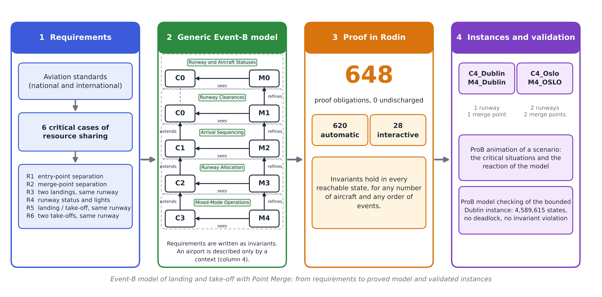
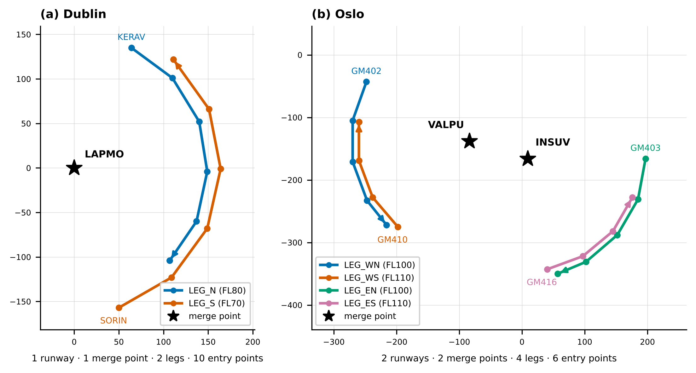

# Event-B model of landing and take-off operations with Point Merge



This repository contains a generic Event-B model of landing and take-off operations in the Terminal Manoeuvring Area (TMA) with Point Merge sequencing, its proofs in Rodin, the theories it uses, two airport instances (Dublin and Oslo), the ProB model checking of bounded Dublin instances, and the ProB animation of six critical cases.

The safety requirements drawn from aviation standards are formalised as invariants and proved with Rodin. The model is generic: an airport is described only by an instance context, and the machines and the generic contexts are not modified.

## Repository structure

```
Verif/            Rodin project: contexts, machines, proofs (uses the theories of TheoryLanding)
TheoryLanding/    Rodin project of the Theory plug-in: theories Seq (sequences) and Time
model-checking/   Rodin projects of the bounded instances used for ProB model checking,
                  the temporal properties and their results, and the detection test
scenarios/        ProB animation of the six critical cases (captures, videos)
docs/             Figures used in this README
```

## Theories

The model uses two theories of the Theory plug-in, in the project `TheoryLanding`: `Seq` defines the sequence operators used for the landing queues (`seqSize`, `seqDelete`, `emptySeq`), and `Time` defines the time notions. The file `TheoryPath.tul` of each model project points to the deployed theories `/TheoryLanding/Seq.dtf` and `/TheoryLanding/Time.dtf`; for this reason, `TheoryLanding` must be imported in the same workspace as the model projects, under this name.

## Model

The development is made of five levels. Each machine refines the previous one and sees a context; the contexts extend each other.

| Level | Context | Machine | Content |
|---|---|---|---|
| 0 | `C0` | `M0` | Runway and aircraft statuses |
| 1 | `C0` | `M1` | Runway clearances |
| 2 | `C1` | `M2` | Arrival sequencing |
| 3 | `C2` | `M3` | Runway allocation |
| 4 | `C3` | `M4` | Mixed-mode operations |

## Airport instances

An instance consists of a context that extends `C3` and a machine that sees this context and refines `M4`.

| Airport | Context | Machine | Runways | Merge points | Legs | Entry points |
|---|---|---|---|---|---|---|
| Dublin | `C4_Dublin` | `M4_Dublin` | 1 (`RWY28L`) | 1 (`LAPMO`) | 2 | 10 |
| Oslo | `C4_Oslo` | `M4_OSLO` | 2 (`RWY01L`, `RWY01R`) | 2 (`VALPU`, `INSUV`) | 4 | 6 |



The figure shows the waypoints, the legs and the merge points of each instance, as described in the instance contexts (coordinates in model units).

The separations by wake turbulence category are taken from the literature. The values of `RwySep` and `DepDepSep` are assumptions of the optimisation article used as the source, not values imposed by a standard.

## Model checking of the Dublin instance

The proved project `Verif` contains the generic model and the instances as they are proved. The model checking is done on separate copies of the Dublin instance, in `model-checking/`. In these copies, the generic contexts and machines (`C0` to `C3`, `M0` to `M4`) are identical to those of `Verif`; only `C4_Dublin` and `M4_Dublin` differ, since they strengthen guards and add a time bound: the explored behaviors are therefore a subset of those of the proved model. The time is bounded by a constant `Horizon`: when it is reached, only the event `end_horizon` remains possible, so that the state space is finite. The clock advances in steps of 60 s.

| Project | Aircraft | Horizon | Choices | States | Transitions | Time | Memory |
|---|---:|---:|---|---:|---:|---:|---:|
| `A_2aircraft_free_choices` | 2 | 1200 s | free (entry time and point, wake category), no urgency | 4,589,615 | 10,051,701 | 6,568 s | 11,862 MiB |
| `B_10aircraft_3scenarios` | 10 | 3600 s | 3 traffic scenarios (variable `plan`), urgent events | 1,860,679 | 2,133,671 | 6,819 s | 9,302 MiB |

ProB explores all reachable states with the deadlock check and the invariant check (mixed breadth-first and depth-first search, "Find other errors" enabled). No deadlocked state and no invariant violation is found in either instance; the loop on `end_horizon` is intended and is not a deadlock. The runs were made on an Intel Core Ultra 5 226V (8 cores, 15.7 GB of memory) under Windows 11.

The twelve LTL and CTL properties (`model-checking/temporal_properties.md`, with their meaning and their formulas) are checked on `B_10aircraft_3scenarios` and all hold. The captures of the results (state statistics and the twelve properties) are in `model-checking/results/`.

To show that the model checking detects a violation, `model-checking/B_test_sans_grd6/` is a copy of instance B in which the guard `grd6` of `Start_takingoff` (separation `RwySep` between a landing and a take-off) is removed. ProB then finds a take-off at the instant the runway is freed, which violates the invariant `M4:inv17`; the replayable trace is in that folder.

This check complements the proofs: the proofs hold for any number of aircraft, whereas the model checking covers these bounded instances only.

## Animation scenarios

The folder `scenarios/` describes the six critical cases animated with ProB on the Dublin data (requirements R1 to R6), with the captures and the videos that replay them. The paper shows a selection of these captures; the others are in this folder.

## Proofs

All proof obligations are discharged in Rodin: 648 in total, 622 automatically and 26 interactively, with none left undischarged.

| Element | Total | Automatic | Interactive |
|---|---:|---:|---:|
| C0 | 6 | 6 | 0 |
| C1 | 13 | 11 | 2 |
| C2 | 0 | 0 | 0 |
| C3 | 1 | 1 | 0 |
| M0 | 48 | 48 | 0 |
| M1 | 66 | 66 | 0 |
| M2 | 294 | 277 | 17 |
| M3 | 90 | 83 | 7 |
| M4 | 130 | 130 | 0 |
| **Total** | **648** | **622** | **26** |

The instance contexts and machines (`C4_*`, `M4_*`) generate no proof obligations. The split between automatic and interactive proofs may vary slightly with the version of the provers, since a rerun of the automatic provers can discharge an obligation that was previously proved interactively; the total and the absence of undischarged obligations do not change.

## Getting started

1. Install Rodin with the Theory plug-in and the ProB plug-in (`Help` > `Install New Software`).
2. Clone or download this repository. The projects do not need to be zipped: Rodin imports them directly from their folders.
3. Import the projects: `File` > `Import` > `General` > `Existing Projects into Workspace`, choose `Select root directory` and select the root folder of the repository. Rodin lists `TheoryLanding`, `Verif` and the three projects of `model-checking/`; select them and enable `Copy projects into workspace`. (`Select archive file` also works if you download the repository as a ZIP.)
4. Import `TheoryLanding` with the other projects, since `Verif` and the model checking projects use its theories. If Rodin reports that a theory is not deployed, right-click the theory in `TheoryLanding` and choose `Deploy`.
5. Let Rodin build the projects (use `Project` > `Clean` first if needed). The generated files (`*.bcc`, `*.bcm`, `*.bpo`, `*.tcl`) are not versioned; the proof files (`*.bpr`, `*.bps`) are applied to the regenerated proof obligations.
6. To animate an airport, open `M4_Dublin` or `M4_OSLO` of `Verif` with ProB. The animation starts with `SETUP_CONTEXT`, which loads the instance context, followed by `INITIALISATION`.
7. To repeat the model checking, open `M4_Dublin` of a project in `model-checking/` with ProB and run the model checker with the deadlock and invariant checks, then the formulas of `model-checking/temporal_properties.md`.
